# LearnTrack
**aniruddha shelke · Roll No. 24b0748 · ET 617 Assignment 1**

A standalone learning web app in which learners log in, study **text, video and quiz** lessons, and
every action they take is recorded as **clickstream data**. Learners can inspect and export their own
clickstream; an instructor can analyse the whole class.

Built for ET 617 (Educational App Design), Assignment 1: *"a web-based application that needs users to
log in and captures their clickstream data"*.

| | |
|---|---|
| **Stack** | Python 3.10+ · Flask · SQLite · plain HTML/CSS/JavaScript (no build step, works offline) |
| **Demo video** | [`docs/demo/learntrack-demo.mp4`](docs/demo/learntrack-demo.mp4) (2 min 40 s, captioned) |
| **Sample data** | [`docs/sample-data/`](docs/sample-data) – real exports produced while recording the demo |
| **Tests** | 24 automated tests (`pytest`), run on every push by GitHub Actions |

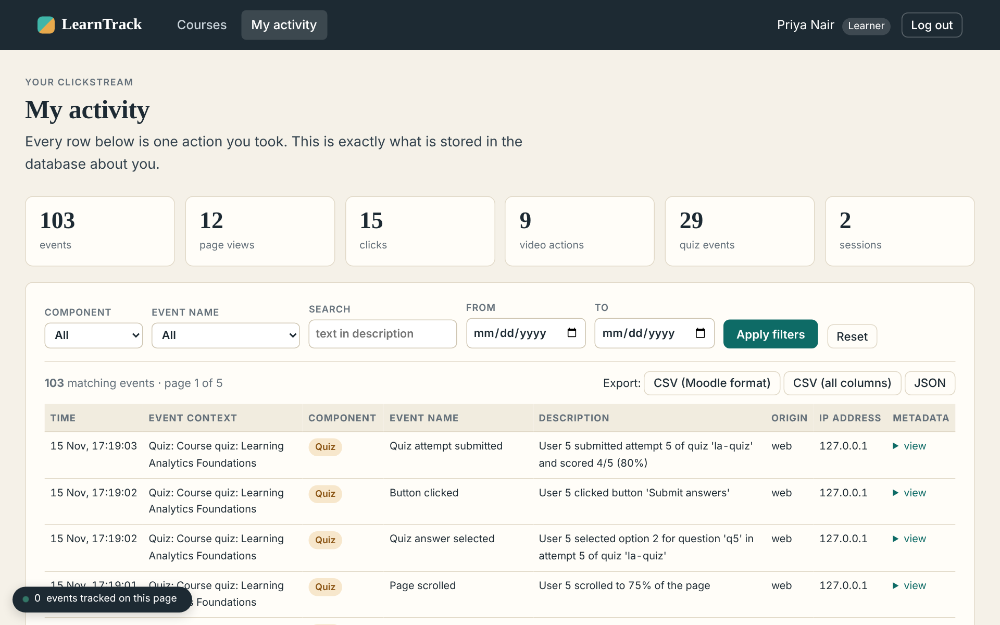

---

## Contents

1. [Features](#features)
2. [Quick start](#quick-start)
3. [Screenshots](#screenshots)
4. [How clickstream tracking works](#how-clickstream-tracking-works)
5. [Events captured](#events-captured)
6. [Data storage](#data-storage)
7. [Retrieving and exporting data](#retrieving-and-exporting-data)
8. [Project structure](#project-structure)
9. [Tests](#tests)
10. [Configuration and deployment](#configuration-and-deployment)
11. [Privacy choices](#privacy-choices)
12. [Limitations and next steps](#limitations-and-next-steps)

---

## Features

**Application**

- Learner registration, login and logout (salted password hashes, signed session cookie, CSRF protection).
- Two roles: **learner** (default for new accounts) and **instructor**.
- Dashboard with per-course progress; lessons can be marked complete; quizzes complete on a pass.

**Learning content and interactivity** – two courses, nine lessons

| Content type | What the learner can do |
|---|---|
| Text | Read, expand "Dig deeper" sections, answer inline quick-check questions with instant feedback |
| Video | Play, pause, seek, skip back 10 s, change speed, mute, go fullscreen |
| Text + Video | A mix of the above in one lesson |
| Quiz | Multiple-choice, graded on the server, unlimited attempts, per-question explanations, review of past attempts |

**Clickstream** – 38 event types (listed [below](#events-captured)): page views, clicks, scroll depth,
tab focus, time on page, every video action with its position, every quiz answer and attempt, logins,
exports.

**Storage and retrieval**

- Every event is one row in SQLite, in the same seven-column shape as the Moodle log given as the
  reference example, plus user, session, page URL and JSON metadata.
- **My activity** page: a learner's own log with filters (component, event name, text, date range).
- **Class analytics** page (instructor): totals, charts, per-learner progress, quiz performance and the
  full log for all users.
- JSON API and CSV/JSON export.

---

## Quick start

Requires Python 3.10 or newer. No database server, Node or internet connection is needed.

```bash
git clone https://github.com/aniruddhashelke20/learntrack.git
cd learntrack

python -m venv .venv
source .venv/bin/activate          # Windows: .venv\Scripts\activate

pip install -r requirements.txt
python app.py
```

Open <http://127.0.0.1:5000>. The database (`instance/learntrack.sqlite`) and the demo accounts are
created automatically on first start.

| Role | Username | Password |
|---|---|---|
| Learner | `learner1` | `learn123` |
| Instructor | `instructor` | `teach123` |

You can also click **Create a learner account** on the login page.

**Try this in two minutes:** log in as `learner1` → open *Learning Analytics Foundations* → answer the
quick check in lesson 1 → play, pause and seek the video in lesson 2 → take the course quiz → open
**My activity** and export the CSV. Then log in as `instructor` and open **Class analytics**.

To wipe all data and start again: `flask --app app reset-db`.

---

## Screenshots

| | |
|---|---|
| 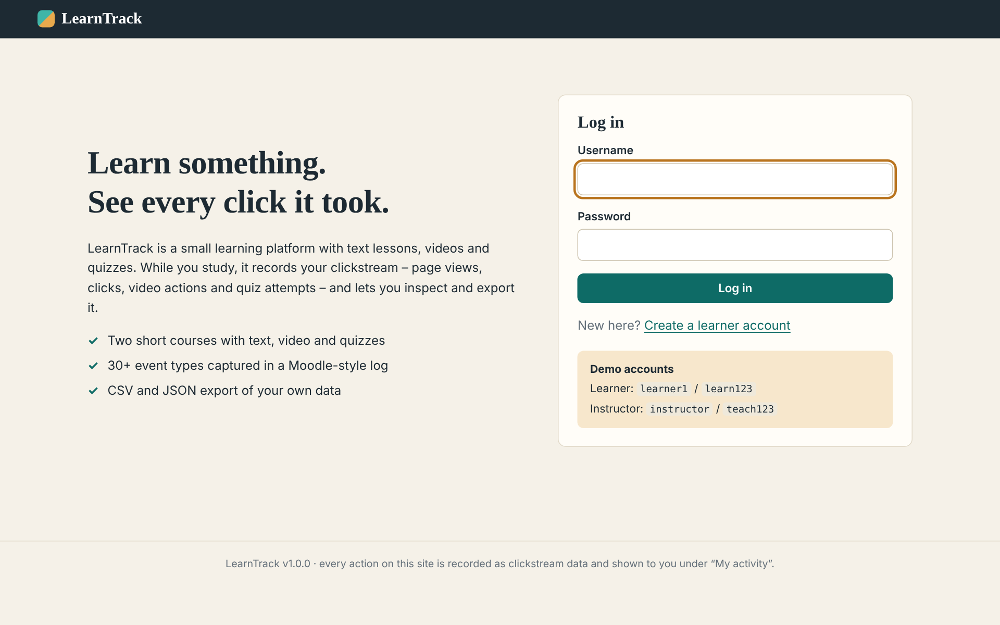 Login with demo accounts | 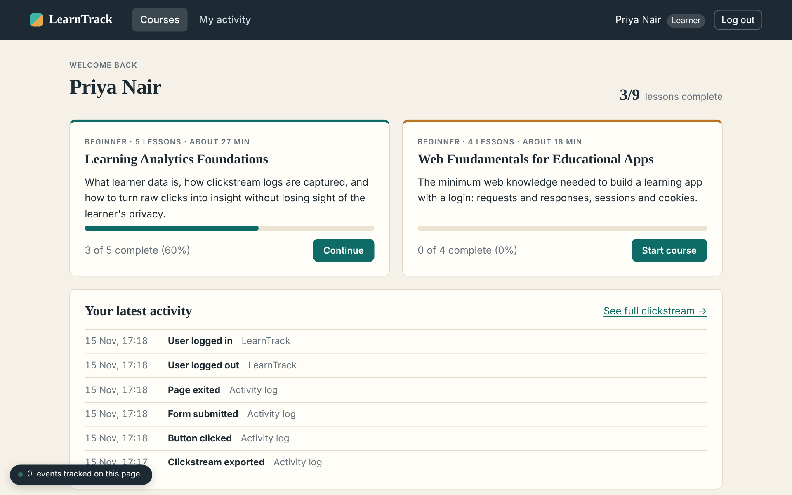 Dashboard with course progress |
| 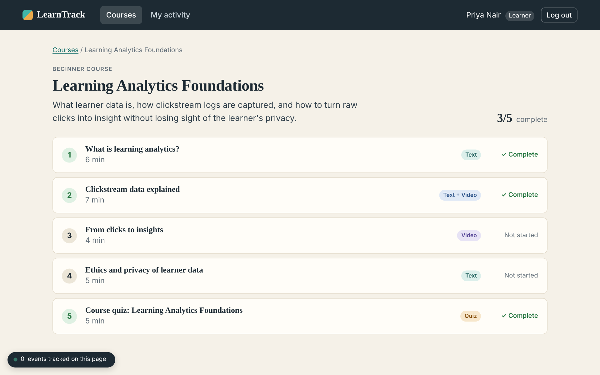 Course page: lesson types and completion | 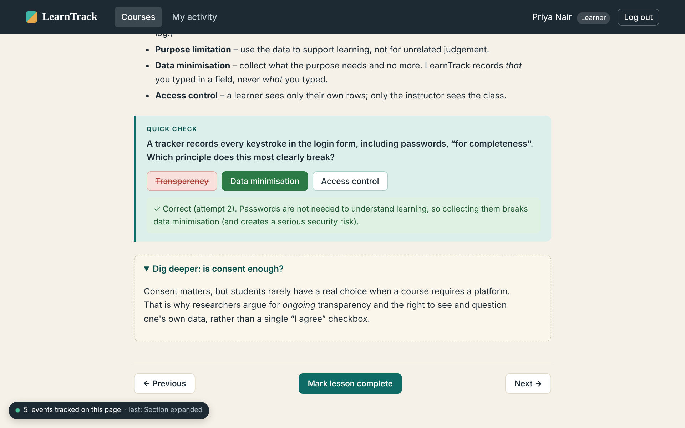 Text lesson: expandable section and quick check |
| 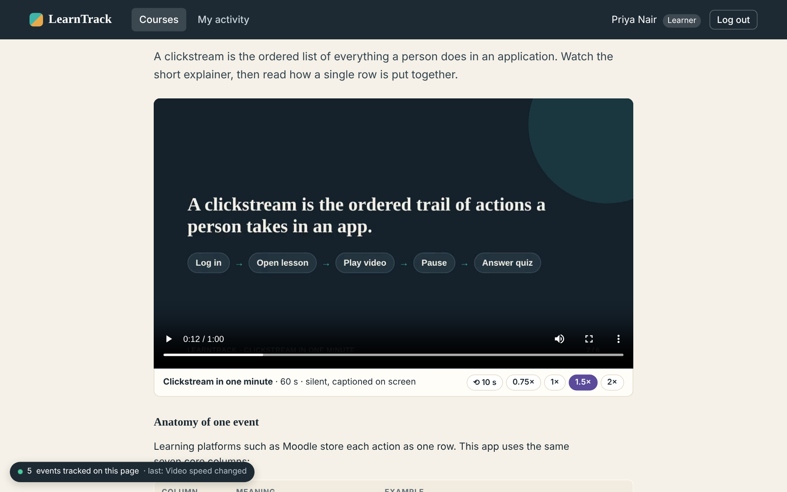 Video lesson: the badge shows events being tracked | 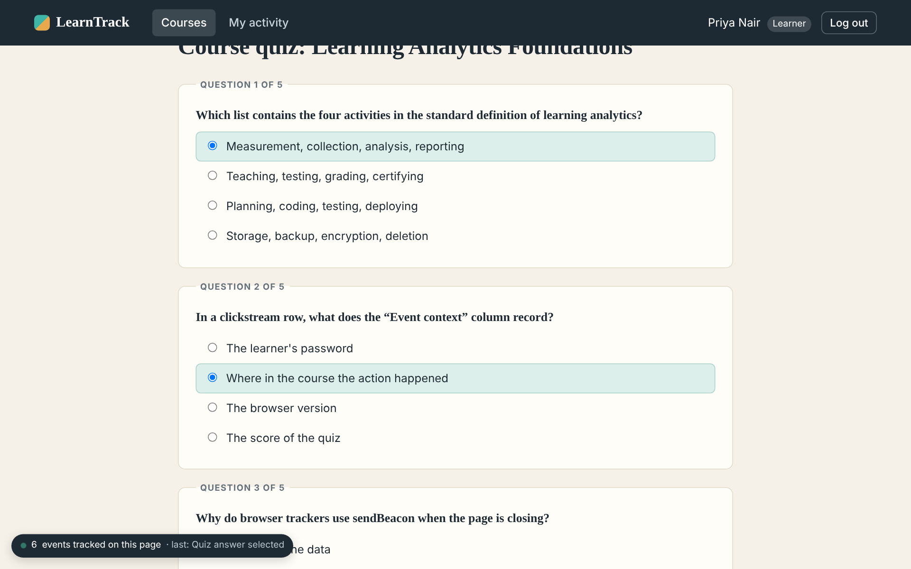 Quiz in progress |
| 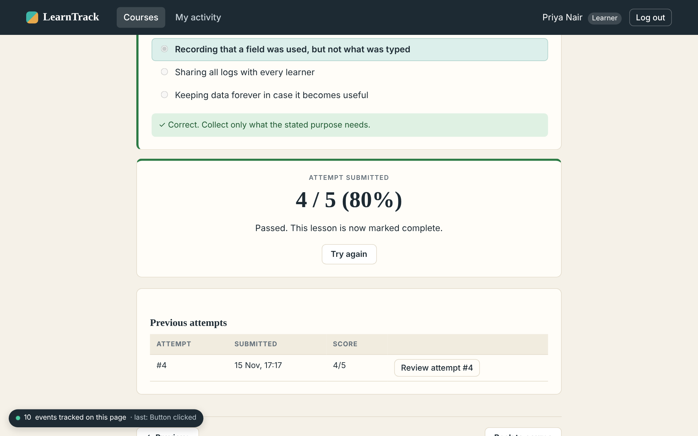 Quiz result | 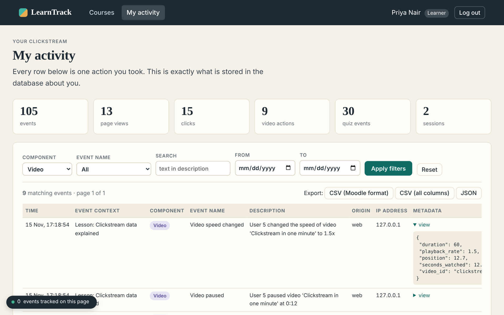 Video events with JSON metadata |
| 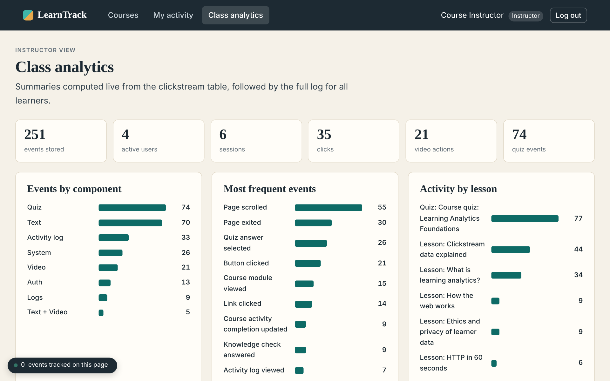 Instructor: class analytics | 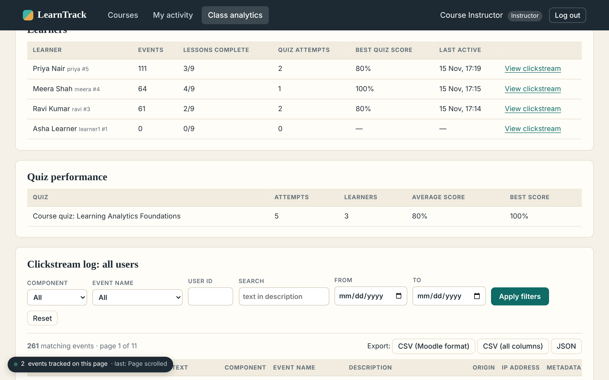 Instructor: learners and quiz performance |

---

## How clickstream tracking works

```
 Browser                                             Server (Flask)                    SQLite
┌──────────────────────────────┐                  ┌─────────────────────────┐      ┌────────────┐
│ tracker.js  (every page)     │  POST /api/events│ tracking.collect_events │      │            │
│  clicks, scroll, tab focus,  ├─────────────────►│  validates, adds user,  ├─────►│   events   │
│  copy, form submit, exit     │  JSON batch      │  session, IP, timestamp │      │            │
│ lesson.js   (lesson pages)   │  (every 2 s or   └─────────────────────────┘      │            │
│  video, quiz answers,        │   10 events;     ┌─────────────────────────┐      │            │
│  expand/collapse             │   sendBeacon     │ log_event() in routes   ├─────►│            │
└──────────────────────────────┘   on page exit)  │  logins, page views,    │      └─────┬──────┘
                                                  │  quiz grading, exports  │            │
                                                  └─────────────────────────┘            ▼
                                             My activity · Class analytics · /api/events · CSV / JSON
```

Two sources write to one table:

- **Server-side** (`log_event` in `learntrack/tracking.py`). Things the server knows for certain are
  logged where they happen: logins, each page view, knowledge-check answers, quiz grading, exports.
  These cannot be lost or faked by the browser.
- **Client-side** (`static/js/tracker.js`, `static/js/lesson.js`). Interactions inside a page are queued
  in the browser and posted in batches. When the page is closing, the queue is sent with
  `navigator.sendBeacon` so the last events are not lost. On logout the queue is flushed *before* the
  session ends.

The server never trusts the browser for identity: `user_id`, `session_id`, IP address and user agent
are filled in on the server from the logged-in session. The browser's timestamp is used only if it is
within ten minutes of the server clock.

A small badge at the bottom-left of every page shows how many events have been tracked on that page
and the name of the latest one, so the tracking is visible to the learner.

---

## Events captured

| Component | Event name | Source | Detail stored in `metadata` |
|---|---|---|---|
| Auth | User registered · User logged in · User login failed · User logged out | server | login method |
| System | Dashboard viewed · Course viewed | server | course id |
| Text / Video / Text + Video / Quiz | Course module viewed (a lesson page view) | server | course id, lesson id, lesson type |
| System | Course activity completion updated | server | lesson id, state |
| any | Link clicked · Button clicked · Element clicked | browser | tag, id, label, link target, x/y position, viewport |
| any | Form submitted | browser | form id and action (never the contents) |
| any | Page scrolled (25 / 50 / 75 / 100 %) | browser | depth |
| any | Tab hidden · Tab visible | browser | seconds away |
| any | Text copied | browser | number of characters |
| any | Page exited | browser | seconds on page, seconds visible, maximum scroll depth |
| Text | Section expanded · Section collapsed | browser | section id |
| Text | Knowledge check answered | server | question id, chosen option, correct or not |
| Video | Video played · Video paused · Video seeked · Video completed | browser | position, duration, speed, seconds actually watched, seek from/to |
| Video | Video progress reached (25 / 50 / 75 %) | browser | percent |
| Video | Video speed changed · Video volume changed · Video muted · Video unmuted | browser | speed, volume |
| Video | Video fullscreen entered · Video fullscreen exited | browser | position |
| Quiz | Quiz attempt started · Quiz attempt submitted · Quiz attempt reviewed | server | attempt id, answers, score, percent, passed |
| Quiz | Quiz answer selected (including changed answers) | browser | attempt id, question id, choice, previous choice |
| Activity log | Activity log viewed · Clickstream exported | server | filters, format, row count |
| Logs | Log report viewed (instructor analytics) | server | filters |

Example rows, taken from [`docs/sample-data/clickstream-moodle-format.csv`](docs/sample-data/clickstream-moodle-format.csv):

```csv
Time,Event context,Component,Event name,Description,Origin,IP address
"15/11/26, 17:16:46",Lesson: Clickstream data explained,Video,Video paused,User 5 paused video 'Clickstream in one minute' at 0:05,web,127.0.0.1
"15/11/26, 17:16:49",Lesson: Clickstream data explained,Video,Video seeked,User 5 skipped back in video 'Clickstream in one minute' from 0:05 to 0:00,web,127.0.0.1
"15/11/26, 17:17:18",Quiz: Course quiz: Learning Analytics Foundations,Quiz,Quiz answer selected,User 5 changed the answer to option 3 for question 'q3' in attempt 4 of quiz 'la-quiz',web,127.0.0.1
"15/11/26, 17:17:22",Quiz: Course quiz: Learning Analytics Foundations,Quiz,Quiz attempt submitted,User 5 submitted attempt 4 of quiz 'la-quiz' and scored 4/5 (80%),web,127.0.0.1
```

---

## Data storage

One SQLite file, four tables (schema in [`learntrack/db.py`](learntrack/db.py)).

**`events`** – the clickstream

| Column | Example | Notes |
|---|---|---|
| `id` | 187 | primary key |
| `ts` | `2026-11-15T11:45:04.212Z` | when it happened (UTC) |
| `received_at` | `2026-11-15T11:45:05.901Z` | when the server stored it |
| `user_id` | 5 | set by the server from the session |
| `session_id` | `9f3c…` | new for every login; groups one visit |
| `event_context` | `Lesson: Clickstream data explained` | Moodle column |
| `component` | `Video` | Moodle column |
| `event_name` | `Video paused` | Moodle column |
| `description` | `User 5 paused video '…' at 0:05` | Moodle column |
| `origin` | `web` | Moodle column |
| `ip_address` | `127.0.0.1` | Moodle column |
| `page_url` | `/course/learning-analytics/lesson/clickstream-explained` | |
| `metadata` | `{"position": 5.2, "playback_rate": 1, …}` | JSON, event-specific |
| `user_agent` | `Mozilla/5.0 …` | |

Indexed on `(user_id, ts)`, `event_name` and `component`.

**`users`** (username, name, email, password hash, role) · **`lesson_progress`** (who completed which
lesson, when) · **`quiz_attempts`** (start and submit time, answers, score).

---

## Retrieving and exporting data

**In the app:** *My activity* (own data) and *Class analytics* (instructor, all users). Both have
filters for component, event name, free text and date range, and export buttons that respect the
current filters.

**API** (requires a logged-in session):

| Method and path | Purpose |
|---|---|
| `POST /api/events` | Store a batch: `{"events": [{event_name, component, context, action, metadata, page_url, ts}]}` |
| `GET /api/events` | Read events as JSON. Query: `component`, `event_name`, `q`, `from`, `to`, `limit`, `offset`, `scope=mine\|all`, `user_id` |
| `GET /api/events/export?format=csv` | CSV with exactly the seven Moodle columns |
| `GET /api/events/export?format=full` | CSV with all columns, including metadata |
| `GET /api/events/export?format=json` | JSON |

`scope=all` and `user_id` are available to instructors only; a learner asking for them gets `403`.

**Directly from the database:**

```bash
sqlite3 instance/learntrack.sqlite \
  "SELECT event_name, COUNT(*) FROM events GROUP BY event_name ORDER BY 2 DESC;"
```

---

## Project structure

```
app.py                     entry point (python app.py)
learntrack/
  __init__.py              app factory, CSRF protection, error pages
  db.py                    SQLite connection, schema, demo accounts, CLI commands
  auth.py                  register / login / logout, role decorators
  content.py               the courses, lessons and quiz questions
  courses.py               dashboard, course and lesson pages, checks, quiz grading
  tracking.py              clickstream: collect, store, query, export, My activity
  analytics.py             instructor dashboard
  templates/               Jinja templates
  static/js/tracker.js     browser tracker (all pages)
  static/js/lesson.js      video, quiz and lesson interactions
  static/css/style.css
  static/videos/           three short lesson videos (MP4)
tests/                     pytest suite
scripts/build_videos.py    regenerates the lesson videos        (development only)
scripts/record_demo.py     records the demo video + screenshots (development only)
docs/                      screenshots, demo video, sample exports
```

---

## Tests

```bash
pip install -r requirements-dev.txt
pytest
```

The 24 tests cover login and registration, access control (learners cannot read other learners'
data), lesson views, knowledge checks, quiz grading and storage, event collection, filtering, and the
exact format of the CSV export. GitHub Actions runs them on Python 3.10 and 3.12
([`.github/workflows/ci.yml`](.github/workflows/ci.yml)).

---

## Configuration and deployment

| Environment variable | Default | Purpose |
|---|---|---|
| `PORT` / `HOST` | `5000` / `127.0.0.1` | where `python app.py` listens |
| `LEARNTRACK_DB` | `instance/learntrack.sqlite` | database file |
| `LEARNTRACK_TZ` | `Asia/Kolkata` | time zone used in the CSV "Time" column |
| `SECRET_KEY` | generated into `instance/secret_key` | signs the session cookie |

`python app.py` uses Flask's development server, which is fine for a demo. For a hosted deployment
(Linux/macOS) run it behind a production server:

```bash
gunicorn --bind 0.0.0.0:8000 app:app
```

Change the demo passwords and set `SECRET_KEY` before putting it on a public address.

---

## Privacy choices

- A learner can always see exactly what is stored about them (*My activity*).
- Learners can read only their own events; the server enforces this, not the page.
- The tracker never records what is typed into a field, only that a field or form was used.
- Passwords are stored as salted hashes.

---

## Limitations and next steps

- The lesson videos are silent, captioned explainers generated for this project.
- SQLite suits a single server; a larger deployment would move to PostgreSQL.
- There is no content editor: courses are defined in `learntrack/content.py`.
- Possible next steps: per-learner timelines, video heat-maps of re-watched passages, xAPI export.

---

## Acknowledgements

Clickstream format modelled on Moodle's standard log. Built with assistance from Claude (Anthropic).
Licensed under the [MIT License](LICENSE).
